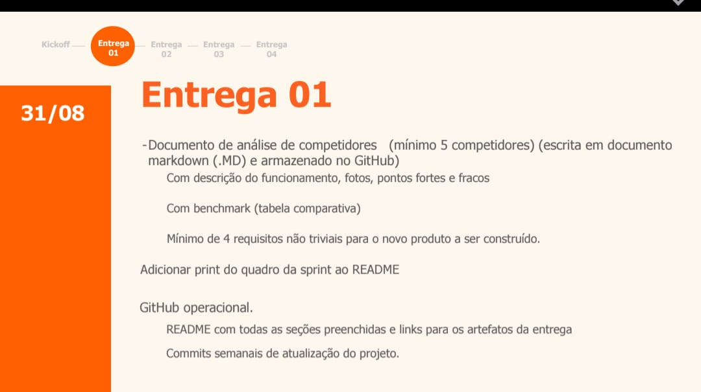
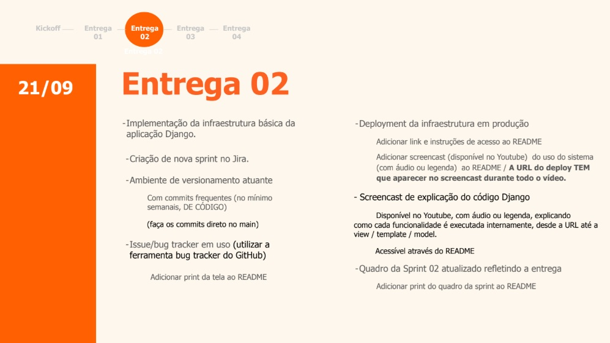
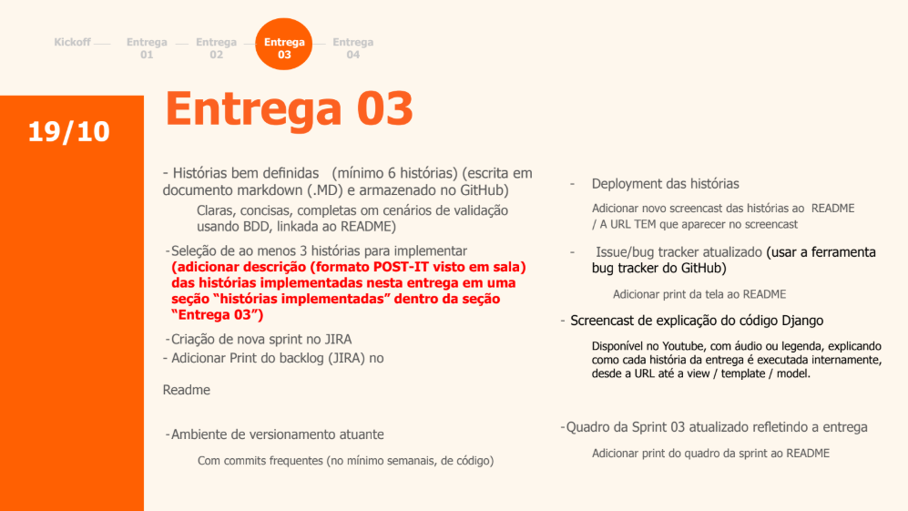
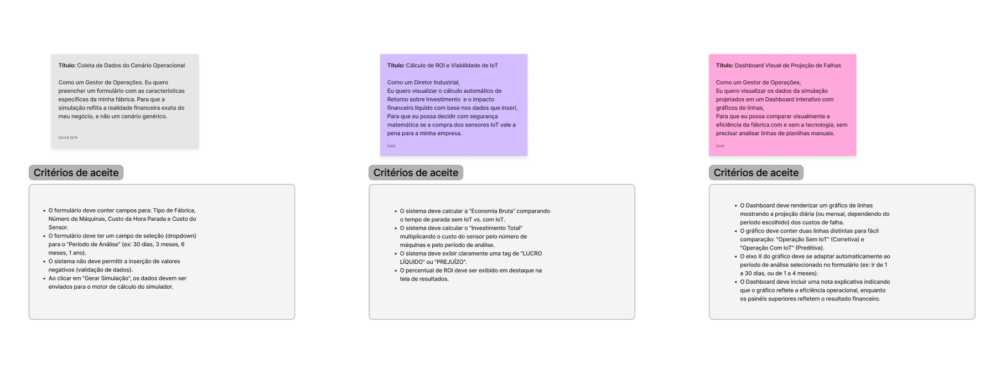

# Projeto Nexus
Repositório destinado ao projetos 2

Jira:https://cesar-team-wuiwsqgi.atlassian.net/jira/software/projects/KAN/list?jql=project%20%3D%20KAN%20ORDER%20BY%20cf%5B10019%5D%20ASC
## Primeira Entrega

Relatório da analise de competidores:

## Segunda Entrega

## Terceira Entrega

## Videos

* Video 1 (Mostrando o Site): https://www.youtube.com/watch?v=VvhxWPgESnw
* Video 2 (Funcionamento do Codigo): https://www.youtube.com/watch?v=V-c6cvEm9U4

## Views do Sistema
Exibe o formulário de contato (contato.html) e renderiza a pagina inical (home.html)
* Se receber um formulário via POST, salva os campos (nome, email, assunto, mensagem) no banco de dados (MensagemContato)

## Formulario
Define o formulário do Django utilizado para coletar os dados operacionais da empresa no simulador de ROI de IoT.
* O Formulário coleta cinco variáveis principais necessárias para realizar o cálculo da economia estimada, sendo elas (num_maquinas): Quantidade total de maquinas que serão monitoradas, (custo_hora_parada): Prejuízo estimado por cada hora em que uma máquina fica inativa, (custo_sensor_iot): Custo de aquisição/instalação de um sensor IoT por máquina, (tipo_empresa): Define o perfil da empresa para ser usado na simulação, (tempo_amostra): Define a quantidade de dias/meses para simular. 

#  Histórias de Usuário

As histórias de usuário descrevem o que cada tipo de usuário da plataforma precisa fazer e por quê. Cada uma tem critérios de aceite, que definem quando a funcionalidade pode ser considerada pronta. A especificação completa também está em [user_stories.md](user_stories.md).

As histórias estão divididas em dois grupos: **Simulação e Visualização de Dados** (histórias 1 a 3) e **Conversão, Atendimento e Melhoria Contínua** (histórias 4 a 6).

##  Simulação e Visualização de Dados

### História de Usuário 1: Coleta de Dados do Cenário Operacional
> **Como** um Gestor de Operações,
> **Eu quero** preencher um formulário com as características específicas da minha fábrica,
> **Para que** a simulação reflita a realidade financeira exata do meu negócio, e não um cenário genérico.

**Critérios de Aceite:**
* O formulário deve conter campos para: Tipo de Fábrica, Número de Máquinas, Custo da Hora Parada e Custo do Sensor.
* O formulário deve ter um campo de seleção (dropdown) para o "Período de Análise" (ex: 30 dias, 3 meses, 6 meses, 1 ano).
* O sistema não deve permitir a inserção de valores negativos (validação de dados).
* Ao clicar em "Gerar Simulação", os dados devem ser enviados para o motor de cálculo do simulador.

---

### História de Usuário 2: Cálculo de ROI e Viabilidade de IoT
> **Como** um Diretor Industrial,
> **Eu quero** visualizar o cálculo automático de Retorno sobre Investimento e o impacto financeiro líquido com base nos dados que inseri,
> **Para que** eu possa decidir com segurança matemática se a compra dos sensores IoT vale a pena para a minha empresa.

**Critérios de Aceite:**
* O sistema deve calcular a "Economia Bruta" comparando o tempo de parada sem IoT vs. com IoT.
* O sistema deve calcular o "Investimento Total" multiplicando o custo do sensor pelo número de máquinas e pelo período de análise.
* O sistema deve exibir claramente uma tag de "LUCRO LÍQUIDO" ou "PREJUÍZO".
* O percentual de ROI deve ser exibido em destaque na tela de resultados.

---

### História de Usuário 3: Dashboard Visual de Projeção de Falhas
> **Como** um Gestor de Operações,
> **Eu quero** visualizar os dados da simulação projetados em um Dashboard interativo com gráficos de linhas,
> **Para que** eu possa comparar visualmente a eficiência da fábrica com e sem a tecnologia, sem precisar analisar linhas de planilhas manuais.

**Critérios de Aceite:**
* O Dashboard deve renderizar um gráfico de linhas mostrando a projeção diária (ou mensal, dependendo do período escolhido) dos custos de falha.
* O gráfico deve conter duas linhas distintas para fácil comparação: "Operação Sem IoT" (Corretiva) e "Operação Com IoT" (Preditiva).
* O eixo X do gráfico deve se adaptar automaticamente ao período de análise selecionado no formulário (ex: ir de 1 a 30 dias, ou de 1 a 4 meses).
* O Dashboard deve incluir uma nota explicativa indicando que o gráfico reflete a eficiência operacional, enquanto os painéis superiores refletem o resultado financeiro.

---

##  Conversão, Atendimento e Melhoria Contínua

### História de Usuário 4: Apresentação da Proposta de Valor e Navegação
> **Como** um Gestor de Indústria visitante,
> **Eu quero** visualizar uma página inicial clara e objetiva que explique os problemas da manutenção reativa e os benefícios da IoT,
> **Para que** eu compreenda o valor da plataforma NEXUS e sinta confiança antes de investir meu tempo testando o simulador.

**Critérios de Aceite:**
* A página inicial (Home) deve conter o texto de "Pitch" principal focando na dor do cliente.
* A Home deve conter botões de *Call to Action* (Chamada para Ação) claros e visíveis, direcionando o usuário diretamente para o "Simulador" ou para o "Contato".
* A barra de navegação superior (Header) deve ser omitida na Landing Page para evitar distrações, mas deve reaparecer automaticamente nas páginas internas (Simulador e Contato) para garantir a navegabilidade.

---

### História de Usuário 5: Captação de Dúvidas e Leads Comerciais
> **Como** um Diretor Industrial interessado,
> **Eu quero** enviar uma mensagem com minhas dúvidas sobre o simulador ou um pedido de proposta comercial através de uma aba de Contato segura,
> **Para que** a equipe NEXUS possa me retornar com um atendimento personalizado ou uma proposta técnica estruturada.

**Critérios de Aceite:**
* O formulário deve conter campos obrigatórios para: Nome, E-mail, Assunto e Mensagem.
* O campo de "Assunto" deve ser um menu suspenso (dropdown) com categorias pré-definidas (ex: Dúvida sobre o Simulador, Proposta Comercial).
* Após o envio, a página deve recarregar exibindo um alerta visual de sucesso (ex: barra verde) para confirmar ao usuário que a ação foi concluída.
* Os dados enviados devem ser salvos de forma persistente e segura no banco de dados relacional do sistema.

---

### História de Usuário 6: Relatório do Resultado em PDF para Compartilhar
> **Como** um Gestor de Operações que precisa convencer a diretoria,
> **Eu quero** baixar o resultado da minha simulação em um relatório em PDF,
> **Para que** eu possa compartilhar os números com meus superiores e decidir com a equipe, sem depender de prints de tela e sem precisar refazer a simulação.

**Critérios de Aceite:**
* A tela de resultados deve ter um botão "Baixar relatório (PDF)", visível sem login ou cadastro.
* Ao clicar, o navegador deve abrir a janela de impressão, de onde o usuário salva o arquivo com "Salvar como PDF".
* O relatório deve conter o cabeçalho com a marca BZU, o segmento e a data de geração, o resumo dos dados informados, o lucro líquido (ou o prejuízo), o ROI, o gráfico de projeção de custos, o "Como calculamos" já aberto e a interpretação do resultado.
* O relatório não deve exibir menu, rodapé do site nem botões, e deve caber em páginas A4 legíveis.
* O rodapé do relatório deve trazer o contato da Bzu (e-mail e site) e o aviso de que o valor é uma estimativa feita com premissas de referência.

### Onde cada história aparece no sistema

| História | Parte do sistema | Seção deste README |
| --- | --- | --- |
| 1 - Coleta de dados | Formulário do simulador | [Formulario](#formulario) |
| 2 - Cálculo de ROI | Simulador financeiro | [Simulador Financeiro](#simulador-financeiro) |
| 3 - Dashboard de falhas | Dashboard de custos | [Dashboard de Custos](#dashboard-de-custos) |
| 4 - Proposta de valor | Página inicial (home.html) | [Views do Sistema](#views-do-sistema) |
| 5 - Contato e leads | Formulário de contato (contato.html) | [Views do Sistema](#views-do-sistema) |
| 6 - Relatório em PDF | Tela de resultado (botão "Baixar relatório") | [Simulador Financeiro](#simulador-financeiro) |

## Dashboard de Custos
Busca os dados no banco de dados (EconomiaIoT) e gera gráficos comparativos usando a biblioteca Plotly.
* Ela funciona somando os custos operacionais (Energia, Manutenção e Paradas) nos cenários Com IoT e Sem IoT, e apartir disso calcula o valor economizado e a porcentagem total de redução.

## Simulador Financeiro
Simula o comportamento financeiro da fábrica ao longo de determinados dias para prever a economia com a instalação de sensores IoT.
* Ela recebe o número de máquinas, o custo por hora parada e o valor do sensor (ou usa valores padrão), ultilizase de Numpy simular horas de paradas diárias com variação realista, também considerando que a tecnologia IoT reduz as paradas inesperadas em 75% e organiza os dados em uma tabela com o Pandas, assim calculando a economia estimada no mês e o Retorno sobre o Investimento (ROI): ROI = (Economia Mensal / Custo Total dos Sensores) * 100

## Tecnologias e Bibliotecas Utilizadas
- **Django:** Framework web para renderização das views e integração com banco de dados.

- **Plotly:** Geração de gráficos interativos para renderização direta em HTML.

- **NumPy:** Geração de distribuições normais estocásticas para simulação realista de paradas.

- **Pandas:** Estruturação e manipulação de séries temporais de dados simulados.
