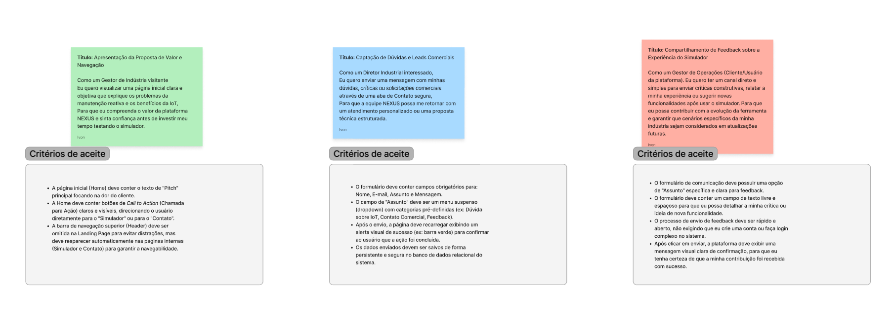

# Projeto Nexus
Repositório destinado ao projetos 2

## Primeira Entrega

Relatório da analise de competidores:

## Segunda Entrega

## Historias do Usuario

**Título: Coleta de Dados do Cenário Operacional**

* Como um Gestor de Operações. Eu quero preencher um formulário com as características específicas da minha fábrica. Para que a simulação reflita a realidade financeira exata do meu negócio, e não um cenário genérico.

* O formulário deve conter campos para: Tipo de Fábrica, Número de Máquinas, Custo da Hora Parada e Custo do Sensor.
* O formulário deve ter um campo de seleção (dropdown) para o "Período de Análise" (ex: 30 dias, 3 meses, 6 meses, 1 ano).
* O sistema não deve permitir a inserção de valores negativos (validação de dados).
* Ao clicar em "Gerar Simulação", os dados devem ser enviados para o motor de cálculo do simulador.

**Título: Cálculo de ROI e Viabilidade de IoT**

* Como um Diretor Industrial, Eu quero visualizar o cálculo automático de Retorno sobre Investimento  e o impacto financeiro líquido com base nos dados que inseri, Para que eu possa decidir com segurança matemática se a compra dos sensores IoT vale a pena para a minha empresa.

* O sistema deve calcular a "Economia Bruta" comparando o tempo de parada sem IoT vs. com IoT.
* O sistema deve calcular o "Investimento Total" multiplicando o custo do sensor pelo número de máquinas e pelo período de análise.
* O sistema deve exibir claramente uma tag de "LUCRO LÍQUIDO" ou "PREJUÍZO".
* O percentual de ROI deve ser exibido em destaque na tela de resultados.

**Título: Dashboard Visual de Projeção de Falhas**

* Como um Gestor de Operações, Eu quero visualizar os dados da simulação projetados em um Dashboard interativo com gráficos de linhas, Para que eu possa comparar visualmente a eficiência da fábrica com e sem a tecnologia, sem precisar analisar linhas de planilhas manuais.
* O Dashboard deve renderizar um gráfico de linhas mostrando a projeção diária (ou mensal, dependendo do período escolhido) dos custos de falha.
* O gráfico deve conter duas linhas distintas para fácil comparação: "Operação Sem IoT" (Corretiva) e "Operação Com IoT" (Preditiva).
* O eixo X do gráfico deve se adaptar automaticamente ao período de análise selecionado no formulário (ex: ir de 1 a 30 dias, ou de 1 a 4 meses).
* O Dashboard deve incluir uma nota explicativa indicando que o gráfico reflete a eficiência operacional, enquanto os painéis superiores refletem o resultado financeiro.

<<<<<<< HEAD
=======
## Videos

* Video 1 (Mostrando o Site): https://www.youtube.com/watch?v=VvhxWPgESnw
* Video 2 (Funcionamento do Codigo): https://www.youtube.com/watch?v=V-c6cvEm9U4

## Views do Sistema
Exibe o formulário de contato (contato.html) e renderiza a pagina inical (home.html)
* Se receber um formulário via POST, salva os campos (nome, email, assunto, mensagem) no banco de dados (MensagemContato)

## Formulario
Define o formulário do Django utilizado para coletar os dados operacionais da empresa no simulador de ROI de IoT.
* O Formulário coleta cinco variáveis principais necessárias para realizar o cálculo da economia estimada, sendo elas (num_maquinas): Quantidade total de maquinas que serão monitoradas, (custo_hora_parada): Prejuízo estimado por cada hora em que uma máquina fica inativa, (custo_sensor_iot): Custo de aquisição/instalação de um sensor IoT por máquina, (tipo_empresa): Define o perfil da empresa para ser usado na simulação, (tempo_amostra): Define a quantidade de dias/meses para simular. 

## Dashboard de Custos
Busca os dados no banco de dados (EconomiaIoT) e gera gráficos comparativos usando a biblioteca Plotly.
* Ela funciona somando os custos operacionais (Energia, Manutenção e Paradas) nos cenários Com IoT e Sem IoT, e apartir disso calcula o valor economizado e a porcentagem total de redução.

## Simulador Financeiro
Simula o comportamento financeiro da fábrica ao longo de determinados dias para prever a economia com a instalação de sensores IoT.
* Ela recebe o número de máquinas, o custo por hora parada e o valor do sensor (ou usa valores padrão), ultilizase de Numpy simular horas de paradas diárias com variação realista, também considerando que a tecnologia IoT reduz as paradas inesperadas em 75% e organiza os dados em uma tabela com o Pandas, assim calculando a economia estimada no mês e o Retorno sobre o Investimento (ROI): ROI = (Economia Mensal / Custo Total dos Sensores) * 100

## Tecnologias e Bibliotecas Utilizadas
- **Django:** Framework web para renderização das views e integração com banco de dados.

- **Plotly:** Geração de gráficos interativos para renderização direta em HTML.

- **NumPy:** Geração de distribuições normais estocásticas para simulação realista de paradas.

- **Pandas:** Estruturação e manipulação de séries temporais de dados simulados.
