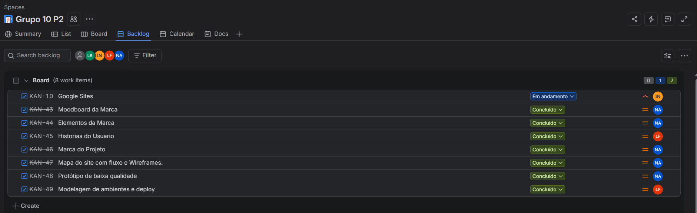
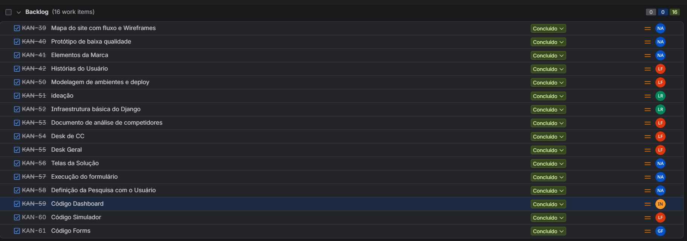
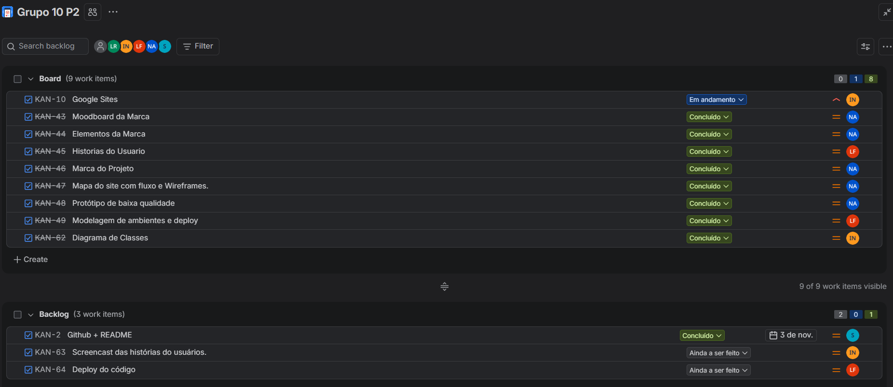
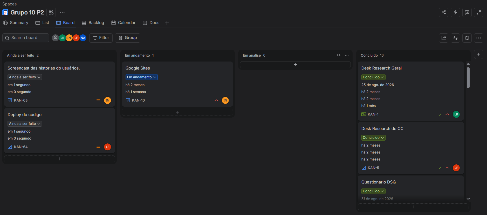

# Projeto Nexus
Repositório destinado ao projetos 2


Jira:https://cesar-team-wuiwsqgi.atlassian.net/jira/software/projects/KAN/list?jql=project%20%3D%20KAN%20ORDER%20BY%20cf%5B10019%5D%20ASC
## Primeira Entrega

Relatório da analise de competidores:



## Segunda Entrega



## Terceira Entrega



## Print da Sprint 


### Histórias de usuário

As 7 histórias do projeto, com critérios de aceite e cenários BDD, estão em [user_stories.md](user_stories.md) e na seção [Histórias de Usuário](#histórias-de-usuário) deste README.

### Histórias implementadas nesta entrega

> **POST-IT · História 1: Coleta de dados do cenário operacional**
> **Como** gestor de operações, **quero** preencher um formulário com as características da minha empresa, **para** a simulação refletir o meu negócio.
> **Pronto quando:** o formulário pergunta tipo de empresa, pontos, funcionamento, custo da hora parada, período e se já há sensores; não pergunta o preço do sensor; recusa valores inválidos.
> **Onde está:** `/simulador/`

> **POST-IT · História 2: Cálculo de ROI e viabilidade de IoT**
> **Como** diretor industrial, **quero** ver o ROI e o resultado estimados, **para** decidir se o monitoramento vale a pena.
> **Pronto quando:** a tela mostra o lucro estimado, o ROI estimado, o investimento em faixa de mercado e o que falta para os sensores se pagarem; quem já tem sensores vê o que já evita e o que ainda dá para ganhar.
> **Onde está:** `/simulador/resultado/`

> **POST-IT · História 3: Dashboard visual de projeção de falhas**
> **Como** gestor de operações, **quero** ver os dados da simulação em gráficos, **para** comparar a operação com e sem IoT.
> **Pronto quando:** o dashboard tem o gráfico "Sem IoT" e "Com IoT", os indicadores, o gráfico de sensibilidade com o ponto de equilíbrio e o comparativo do período.
> **Onde está:** `/dashboard/`

> **POST-IT · História 7: Relatório do resultado em PDF**
> **Como** gestor que precisa convencer a diretoria, **quero** baixar o resultado em PDF, **para** compartilhar os números sem refazer a simulação.
> **Pronto quando:** o botão "Baixar relatório completo (PDF)" abre a impressão do navegador com o resultado, o dashboard e o "Como calculamos" em páginas A4.
> **Onde está:** `/dashboard/relatorio/`

### Backlog do Jira

Jira: https://cesar-team-wuiwsqgi.atlassian.net/jira/software/projects/KAN/list?jql=project%20%3D%20KAN%20ORDER%20BY%20cf%5B10019%5D%20ASC

<!-- Para publicar o print, salve o arquivo Backlog_Entrega03.png na pasta do projeto e troque este comentário por:  -->

### Quadro da Sprint 03

<!-- Para publicar o print, salve o arquivo Quadro_Sprint03.png na pasta do projeto e troque este comentário por:  -->

### Issue e bug tracker (GitHub)

<!-- Para publicar o print, salve o arquivo BugTracker_Entrega03.png na pasta do projeto e troque este comentário por:  -->

### Screencasts

* Deployment das histórias (a URL aparece no vídeo): link a ser adicionado.
* Explicação do código Django, de cada história até a view, o template e o model: link a ser adicionado.
<!-- Troque "link a ser adicionado" pelo link do YouTube de cada vídeo. -->

### Versionamento

Os commits são frequentes e ficam em https://github.com/Lucca-LBF/projeto-nexus/commits/main

## Videos

* Video 1 (Mostrando o Site): https://www.youtube.com/watch?v=VvhxWPgESnw
* Video 2 (Funcionamento do Codigo): https://www.youtube.com/watch?v=V-c6cvEm9U4

## Como rodar o projeto

```
pip install -r requirements.txt
python manage.py migrate
python manage.py runserver
```

No Windows também dá para dar dois cliques no `run.bat`, que atualiza o banco e inicia o servidor. Depois é só abrir http://127.0.0.1:8000/.

Páginas do sistema:

| Endereço | O que é |
| --- | --- |
| `/` | Página inicial (home.html) |
| `/simulador/` | Formulário do simulador, uma pergunta por tela |
| `/simulador/resultado/` | Resultado da simulação (ROI, lucro ou prejuízo, explicação e feedback) |
| `/dashboard/` | Dashboard com indicadores e gráficos da última simulação |
| `/contato/` | Formulário de contato |
| `/admin/` | Painel administrativo do Django (mensagens recebidas) |

## Estrutura do projeto

| Arquivo ou pasta | Responsabilidade |
| --- | --- |
| `config/` | Configurações do Django, rotas principais e as views da home e do contato |
| `simulador/segmentos.py` | Catálogo dos segmentos: textos, premissas e perguntas de cada ramo de empresa |
| `simulador/forms.py` | Formulário do simulador e todas as validações |
| `simulador/views.py` | Motor de cálculo (NumPy e Pandas) e telas do formulário e do resultado |
| `simulador/feedback.py` | Textos de retorno ao usuário, "Como calculamos" e link do WhatsApp da Bzu |
| `simulador/models.py` | Modelo `MensagemContato`, que guarda as mensagens do contato |
| `dashboard/views.py` | Indicadores e gráficos (Plotly) lidos da simulação que está na sessão |
| `dashboard/models.py` | Modelos `SensorData` e `EconomiaIoT` (esse último vem da primeira versão do dashboard e não é mais usado pelas telas) |
| `templates/` e `simulador/templates/` | Páginas HTML (base, home, contato, simulador, resultado e dashboard) |
| `static/CSS/style.css` | Tema visual da Bzu, estilos do formulário passo a passo e da impressão do relatório |

## Views do Sistema
Cada tela do sistema é uma view do Django:
* **Home (`/`)**: renderiza a página inicial (home.html) com a proposta de valor, os benefícios do IoT e os botões para o simulador e para o contato.
* **Contato (`/contato/`)**: exibe o formulário de contato (contato.html). Se receber um formulário via POST, salva os campos (nome, email, assunto, mensagem) no banco de dados (`MensagemContato`) e recarrega a página com uma mensagem de sucesso. O campo "Assunto" tem as opções: dúvida sobre o simulador, proposta comercial, feedback/sugestões e outros.
* **Formulário do simulador (`/simulador/`)**: monta o formulário conforme o segmento e, se já houver uma simulação na sessão, preenche os campos com as respostas anteriores. O endereço `/simulador/?nova=1` apaga a simulação guardada e volta ao formulário em branco.
* **Resultado (`/simulador/resultado/`)**: recebe o formulário, valida de novo no servidor, roda a simulação e mostra o resultado. Sem simulação na sessão, volta para o formulário.
* **Dashboard (`/dashboard/`)**: usa a simulação guardada na sessão. Sem simulação, volta para o formulário.

## Segmentos
O arquivo `simulador/segmentos.py` é o catálogo de segmentos. Cada segmento define o nome, as perguntas que aparecem, as premissas do cálculo e os textos de retorno. Para criar um segmento novo, basta copiar um bloco do dicionário `SEGMENTOS` e trocar os textos.

Segmentos disponíveis: Indústria em geral, Indústria têxtil, Indústria pesada, Cadeia fria e refrigeração, Alimentos e bebidas, Saúde e farmacêutica, Água, gás e energia, Edifícios inteligentes, Cidades inteligentes e Agronegócio.

O que cada segmento configura:
* **modelo**: `paradas` (a pessoa informa o custo de uma hora parada e o sistema calcula as horas perdidas) ou `perdas` (a pessoa informa quanto perde por mês).
* **taxa_falha_base**: horas de parada por máquina ao dia (só no modelo `paradas`).
* **reducao_iot**: percentual das perdas que o IoT evita.
* **custo_ponto** e **custo_ponto_faixa**: custo mensal estimado por ponto monitorado (R$ por ponto por mês), só com os sensores: sensor e instalação diluídos em 36 meses, mais assinatura e conectividade. O valor central entra no lucro e no ROI, e a faixa (mínimo e máximo) aparece como "investimento estimado". São estimativas de mercado a partir de preços públicos de fornecedores de IoT, não são preço da Bzu. Medir temperatura (refrigeração, agro) sai mais barato que medir vibração (indústria pesada).
* **rotulo_pontos**: como chamar o que é monitorado (máquinas, câmaras frias, edifícios e assim por diante).
* **intro, campos, prioridades, monitorar, conexao e caso**: textos do formulário e do retorno.

Premissas de referência (podem ser trocadas pela Bzu quando tiver dados reais):

| Segmento | Modelo | Horas de parada por máquina ao dia | Redução com IoT |
| --- | --- | --- | --- |
| Indústria em geral | paradas | 0,04 | 15% |
| Indústria têxtil | paradas | 0,06 | 12% |
| Indústria pesada | paradas | 0,03 | 25% |
| Cadeia fria e refrigeração | paradas | 0,04 | 35% |
| Demais segmentos | perdas | não se aplica | 15% |

O mesmo arquivo guarda as opções que valem para todos os segmentos: regime de funcionamento (1 turno, 2 turnos ou 24 horas), acompanhamento atual, conexão disponível no local e os percentuais da estimativa "Não sei o valor".

## Formulario
O arquivo `simulador/forms.py` define o formulário do Django (`DadosEmpresaForm`) que coleta os dados da empresa para o simulador de ROI de IoT. As perguntas mudam conforme o segmento escolhido: os campos que o segmento não usa ficam desligados e escondidos.

Campos do formulário:
* `tipo_industria`: segmento da empresa. É a primeira pergunta, porque as outras dependem dela.
* `num_maquinas`: quantidade de máquinas (ou pontos) que serão monitoradas.
* `regime_funcionamento`: 1 turno, 2 turnos ou 24 horas por dia. Só entra na conta nos segmentos de `paradas`.
* `custo_hora_parada`: prejuízo de cada hora parada (segmentos de `paradas`).
* `perda_mensal`: quanto a empresa perde por mês (segmentos de `perdas`).
* `conserto_mensal`: gasto mensal com conserto de emergência. É opcional e, se informado, entra na economia.
* `tempo_amostra`: período da análise em dias (30, 60, 90, 120, 180 ou 360).
* `acompanhamento_atual`: se a empresa já tem sensores (nenhum, acompanhamento manual, sensores em alguns pontos ou na maior parte dos pontos). Define quanto da economia já está sendo aproveitado.
* `prioridade` e `conexao_local`: perguntas de contexto. Não entram na conta, só personalizam o retorno.

O formulário **não pergunta o custo do sensor**: o investimento é estimado pelo tipo de empresa, em faixa (veja `custo_ponto_faixa` em Segmentos).

Validações (o servidor sempre confere de novo, mesmo que o navegador já tenha conferido):
* Não aceita valores negativos, e os campos obrigatórios precisam ser maiores que zero.
* Cada campo tem um limite máximo e aceita no máximo 2 casas decimais.
* As mensagens de erro estão em português e o campo com erro fica com a borda vermelha.

No navegador, o formulário aparece **uma pergunta por tela**, com barra de progresso, e uma tela de carregamento rápida antes do resultado. Isso é feito em JavaScript em cima do mesmo formulário do Django, então o sistema continua funcionando se o JavaScript falhar. Quem não sabe um valor pode usar "Não sei o valor, quero estimar": informa o gasto mensal e quanto acha que se perde (cerca de 5%, 10% ou 20%) e o formulário preenche o campo.

## Simulador Financeiro
O motor de cálculo fica em `simulador/views.py`. Ele simula o comportamento financeiro da empresa dia a dia e estima a economia com a instalação de sensores IoT.
* Usa **NumPy** para gerar as perdas diárias com variação realista (distribuição normal, com semente fixa para o resultado ser sempre o mesmo para os mesmos dados) e organiza a série em uma tabela com o **Pandas**.
* No modelo `paradas`, as horas perdidas por dia são: máquinas × taxa de falha do segmento × fator do regime (1 turno 0,5; 2 turnos 1,0; 24 horas 1,5). Cada hora parada custa o valor informado.
* No modelo `perdas`, a perda mensal informada é dividida por dia, com variação.
* O IoT reduz essas perdas no percentual do segmento (`reducao_iot`). O conserto de emergência, quando informado, é reduzido na mesma proporção.
* **Sensores que a empresa já tem:** a resposta de `acompanhamento_atual` define a parte dos pontos que já tem sensores (nenhum e manual: 0%; alguns pontos: 30%; maior parte: 70%, hipóteses do simulador). A economia total possível é dividida em **já aproveitada** (com os sensores atuais) e **ainda disponível ao ampliar**. O lucro, o ROI e os gráficos valem para a ampliação, e a tela sugere ampliar a cobertura.
* Fórmulas finais (para os pontos que ainda não têm sensor):
  * Economia bruta = custo total sem IoT − custo total com IoT
  * Investimento = pontos a monitorar × custo estimado por ponto do tipo de empresa × meses do período
  * Resultado líquido = economia bruta − investimento
  * ROI = (resultado líquido ÷ investimento) × 100
* O preço do sensor **não é perguntado**: o custo por ponto de cada segmento fica no `segmentos.py` como estimativa de mercado (faixa mínima e máxima). A tela mostra só a faixa do investimento total, nunca o preço por ponto, e diz que o valor final é definido pela Bzu na proposta.
* O resultado aparece como **LUCRO LÍQUIDO ESTIMADO** com o ROI estimado em destaque. Quando o lucro seria negativo, a tela não mostra valor negativo nem vermelho: mostra a **ECONOMIA ESTIMADA** e a redução de perdas necessária para os sensores se pagarem. Tudo é tratado como estimativa, e sempre há um caminho sugerido para economizar. O investimento aparece como faixa estimada ("entre R$ X e R$ Y"), considera só os sensores, e a página avisa que não é preço da Bzu (gateways, plataforma e diagnóstico ficam para a proposta da Bzu). Lucro e ROI usam o valor central da faixa.
* Os dados da simulação ficam guardados na **sessão** do usuário, sem exigir cadastro, e é dela que o dashboard lê. O resultado tem um botão para baixar o relatório em PDF, que usa a impressão do navegador ("Salvar como PDF"), sem gerar nem guardar arquivo no servidor.

## Retorno ao usuário (feedback.py)
O arquivo `simulador/feedback.py` monta tudo o que a empresa lê junto com o número do resultado:
* **Leitura do resultado**: texto conforme o ROI estimado (potencial de economia com caminhos para chegar ao retorno, retorno moderado ou retorno alto), quanto se evita de perda para cada R$ 1,00 investido, a redução mínima de perdas para os sensores se pagarem e, quando o resultado é negativo, o lucro estimado no extremo mais econômico da faixa de investimento. O **ROI estimado aparece sempre**: no positivo, o valor central com a faixa de investimento; no negativo, a faixa (por exemplo "de -35% a 12%"). O que falta para os sensores se pagarem aparece como redução de perdas necessária ou, se nem 100% bastaria, como o valor que a hora parada (ou a perda mensal) teria que ter. A tela nunca pede só para "revisar valores".
* **Monitoramento em tempo real**: bloco antes do fechamento sobre medir 24 horas por dia e depender menos de rondas e anotações (menor dependência do fator humano).
* **Seus sensores atuais** (`montar_sensores_atuais`): para quem já tem sensores, mostra quanto já está sendo evitado, quanto ainda dá para ganhar ampliando e sugere ampliar a cobertura.
* **Personalização**: usa as respostas de prioridade, acompanhamento atual e conexão do local para sugerir por onde começar, o que monitorar e qual conexão usar (Wi-Fi, LoRa ou LTE), além de um caso de referência do segmento.
* **Como calculamos** (`explicar_calculo`): o passo a passo da conta em frases, com os números da própria simulação.
* **Contato com a Bzu**: link do WhatsApp com a mensagem de diagnóstico já preenchida (só segmento, quantidade e ROI, sem dado pessoal), e-mail e site.

## Dashboard de Custos
O arquivo `dashboard/views.py` monta o dashboard a partir da simulação guardada na sessão (e não mais do banco de dados) e gera os gráficos com a biblioteca **Plotly**.
* **Indicadores**: resultado líquido com ROI, economia evitada por mês, horas de parada evitadas (segmentos de `paradas`), economia mensal por ponto, quanto já é evitado com os sensores atuais (quando existem) e redução efetiva de perdas. Quando o resultado é negativo, o dashboard não mostra valor negativo nem vermelho: mostra o "Potencial de economia", a redução necessária para os sensores se pagarem e o lucro estimado no mínimo da faixa de investimento. Também mostra o "Investimento estimado" em faixa.
* **Projeção de custos**: gráfico de linhas "Sem IoT" e "Com IoT". Até 30 dias o eixo é diário, e acima disso é mensal.
* **Economia por redução de perdas**: mostra como a economia muda se a redução real for maior ou menor que a premissa, com uma marca no ponto de equilíbrio (a redução mínima para os sensores se pagarem). A linha do investimento não é desenhada.
* **Comparativo do período**: barras com o custo sem IoT e o custo com IoT.
* **Dados informados e premissas de referência** usadas na simulação.

## Tecnologias e Bibliotecas Utilizadas
- **Django:** Framework web para as views, formulários, sessão e banco de dados (SQLite).

- **Plotly:** Geração de gráficos interativos para renderização direta em HTML.

- **NumPy:** Geração de distribuições normais estocásticas para simulação realista de paradas.

- **Pandas:** Estruturação e manipulação de séries temporais de dados simulados.

- **Bootstrap 5:** Layout e componentes da interface, com o tema visual da Bzu em `static/CSS/style.css`.

#  Histórias de Usuário

As histórias de usuário descrevem o que cada tipo de usuário da plataforma precisa fazer e por quê. Cada uma tem critérios de aceite, que definem quando a funcionalidade pode ser considerada pronta, e cenários de validação escritos em BDD (Dado, Quando, Então). A especificação completa também está em [user_stories.md](user_stories.md).

As histórias estão divididas em dois grupos: **Simulação e Visualização de Dados** (histórias 1 a 3) e **Conversão, Atendimento e Melhoria Contínua** (histórias 4 a 7).

##  Simulação e Visualização de Dados


### História de Usuário 1: Coleta de Dados do Cenário Operacional
> **Como** um Gestor de Operações,
> **Eu quero** preencher um formulário com as características específicas da minha empresa,
> **Para que** a simulação reflita a realidade financeira do meu negócio, e não um cenário genérico.

**Critérios de Aceite:**
* O formulário, com uma pergunta por tela, pergunta o tipo de empresa, o número de máquinas (ou pontos de medição), o regime de funcionamento, o custo da hora parada (ou a perda mensal, conforme o tipo de empresa), o conserto de emergência (opcional), o período de análise, a prioridade, se a empresa já tem sensores e a conexão do local.
* O formulário **não pergunta o custo do sensor**: o investimento é estimado pelo tipo de empresa, em faixa.
* O período de análise é um campo de seleção (dropdown) com 30, 60, 90, 120, 180 ou 360 dias.
* O sistema não aceita valores negativos nem zero nos campos obrigatórios, e mostra mensagens de erro em português.
* Ao concluir, o botão "Ver quanto posso economizar" envia os dados para o motor de cálculo do simulador.

**Cenários (BDD):**
```gherkin
Funcionalidade: Coleta de dados do cenário operacional

  Cenário: Preencher o formulário e ver o resultado
    Dado que estou na página do simulador
    Quando escolho o tipo de empresa e informo 100 máquinas, custo da hora parada de R$ 2.000 e período de 90 dias
    E respondo as demais perguntas
    Então o simulador calcula a simulação e abre a tela de resultado

  Cenário: Valor inválido não avança
    Dado que estou na pergunta "Número de máquinas"
    Quando informo 0 e clico em "Continuar"
    Então vejo a mensagem "Informe pelo menos 1."
    E continuo na mesma pergunta

  Cenário: O custo do sensor não é perguntado
    Dado que respondo o formulário até o fim
    Então em nenhuma tela sou perguntado sobre o preço do sensor
```

---

### História de Usuário 2: Cálculo de ROI e Viabilidade de IoT
> **Como** um Diretor Industrial,
> **Eu quero** visualizar o cálculo automático do retorno sobre o investimento e do impacto financeiro estimado com base nos dados que inseri,
> **Para que** eu possa decidir com segurança se o monitoramento com sensores IoT vale a pena para a minha empresa.

**Critérios de Aceite:**
* O sistema calcula a "Economia Bruta" comparando o custo de paradas e perdas sem IoT e com IoT, usando a redução de referência do tipo de empresa.
* O investimento é uma **estimativa de mercado em faixa** ("entre R$ X e R$ Y"), calculada pelos pontos a monitorar, pelo custo por ponto do tipo de empresa e pelos meses do período. A tela avisa que não é preço da Bzu.
* O lucro líquido estimado e o **ROI estimado** aparecem sempre na tela de resultado e usam o valor central da faixa.
* Quando o lucro seria negativo, a tela não usa vermelho nem mostra valor negativo como destaque: mostra a economia estimada, o ROI em faixa e o que falta para os sensores se pagarem.
* Se a empresa já tem sensores, o sistema mostra quanto já é evitado e quanto ainda dá para ganhar ampliando, e o investimento vale só para os pontos que ainda não têm sensor.

**Cenários (BDD):**
```gherkin
Funcionalidade: Cálculo de ROI e viabilidade de IoT

  Cenário: Resultado positivo
    Dado que informei 60 máquinas, custo da hora parada de R$ 2.000 e período de 90 dias
    Quando vejo a tela de resultado
    Então vejo o "LUCRO LÍQUIDO ESTIMADO" e o "ROI estimado" em destaque
    E vejo o investimento estimado como uma faixa, marcada como estimativa de mercado

  Cenário: Resultado que ainda não paga os sensores
    Dado que informei 60 máquinas, custo da hora parada de R$ 500 e período de 90 dias
    Quando vejo a tela de resultado
    Então vejo a "ECONOMIA ESTIMADA" em vez de um prejuízo
    E vejo o ROI estimado em faixa, sem vermelho
    E vejo quanto a redução de perdas precisa ser para os sensores se pagarem

  Cenário: Empresa que já tem sensores
    Dado que respondi que já temos sensores em alguns pontos
    Quando vejo a tela de resultado
    Então vejo quanto já é evitado com os sensores atuais
    E vejo quanto ainda dá para ganhar ampliando o monitoramento
```

---

### História de Usuário 3: Dashboard Visual de Projeção de Falhas
> **Como** um Gestor de Operações,
> **Eu quero** visualizar os dados da simulação projetados em um Dashboard interativo com gráficos,
> **Para que** eu possa comparar visualmente a eficiência da empresa com e sem a tecnologia, sem precisar analisar planilhas.

**Critérios de Aceite:**
* O Dashboard renderiza um gráfico de linhas com a projeção dos custos de falha, diária (até 30 dias) ou mensal (períodos maiores).
* O gráfico tem duas linhas distintas para comparação: "Operação Sem IoT" (Corretiva) e "Operação Com IoT" (Preditiva).
* O eixo X se adapta automaticamente ao período escolhido no formulário.
* O Dashboard mostra indicadores (resultado ou potencial de economia, investimento estimado, economia por mês e redução efetiva de perdas), o gráfico de sensibilidade com o ponto de equilíbrio e o comparativo do período.
* O Dashboard inclui uma nota explicando que o gráfico reflete a eficiência operacional, enquanto os indicadores no topo refletem o resultado financeiro.

**Cenários (BDD):**
```gherkin
Funcionalidade: Dashboard visual de projeção de falhas

  Cenário: Ver o dashboard depois de simular
    Dado que fiz uma simulação de 90 dias
    Quando abro o Dashboard
    Então vejo o gráfico de linhas "Sem IoT" e "Com IoT" com o eixo em meses
    E vejo os indicadores da simulação

  Cenário: Abrir o dashboard sem simulação
    Dado que ainda não fiz nenhuma simulação
    Quando abro o Dashboard
    Então sou levado ao formulário do simulador
```

---

##  Conversão, Atendimento e Melhoria Contínua


### História de Usuário 4: Apresentação da Proposta de Valor e Navegação
> **Como** um Gestor de Indústria visitante,
> **Eu quero** visualizar uma página inicial clara e objetiva que explique os problemas da manutenção reativa e os benefícios da IoT,
> **Para que** eu compreenda o valor da plataforma e sinta confiança antes de investir meu tempo testando o simulador.

**Critérios de Aceite:**
* A página inicial (Home) contém o texto principal focado na dor do cliente.
* A Home tem botões de chamada para ação claros, que levam direto ao "Simulador" ou ao "Contato".
* A barra de navegação superior (Início, Simulador e Contato) aparece em todas as páginas, para o usuário navegar a qualquer momento.

**Cenários (BDD):**
```gherkin
Funcionalidade: Apresentação da proposta de valor e navegação

  Cenário: Ir da página inicial ao simulador
    Dado que estou na página inicial
    Quando clico em "Descobrir minha economia"
    Então abro o formulário do simulador

  Cenário: Ir da página inicial ao contato
    Dado que estou na página inicial
    Quando clico em "Tirar uma dúvida"
    Então abro a página de contato
```

---

### História de Usuário 5: Captação de Dúvidas e Leads Comerciais
> **Como** um Diretor Industrial interessado,
> **Eu quero** enviar uma mensagem com minhas dúvidas sobre o simulador ou um pedido de proposta comercial através de uma aba de Contato,
> **Para que** a equipe possa me retornar com um atendimento personalizado ou uma proposta técnica estruturada.

**Critérios de Aceite:**
* O formulário tem campos obrigatórios para Nome, E-mail, Assunto e Mensagem.
* O campo "Assunto" é um menu suspenso com categorias pré-definidas (Dúvida sobre o Simulador, Proposta Comercial, Feedback / Sugestões e Outros).
* Depois do envio, a página mostra um alerta visual de sucesso ("Mensagem Enviada!").
* Os dados enviados são salvos no banco de dados e ficam disponíveis no painel administrativo.

**Cenários (BDD):**
```gherkin
Funcionalidade: Captação de dúvidas e leads comerciais

  Cenário: Enviar uma mensagem de contato
    Dado que estou na página de contato
    Quando preencho nome, e-mail, assunto "Proposta Comercial" e mensagem e clico em enviar
    Então vejo o alerta "Mensagem Enviada!"
    E a mensagem fica salva no painel administrativo

  Cenário: Campo obrigatório vazio
    Dado que estou na página de contato
    Quando tento enviar sem preencher o e-mail
    Então o navegador pede o preenchimento do campo e a mensagem não é enviada
```

---

### História de Usuário 6: Compartilhamento de Feedback sobre a Experiência do Simulador
> **Como** um Gestor de Operações (cliente e usuário da plataforma),
> **Eu quero** ter um canal direto e simples para enviar críticas construtivas, relatar a minha experiência ou sugerir novas funcionalidades após usar o simulador,
> **Para que** eu possa contribuir com a evolução da ferramenta e garantir que cenários específicos da minha indústria sejam considerados em atualizações futuras.

**Critérios de Aceite:**
* O formulário de contato tem a opção "Feedback / Sugestões" no campo "Assunto", separada das opções de dúvida e de proposta comercial.
* O formulário tem um campo de texto livre e espaçoso para detalhar a crítica ou a ideia.
* O envio é rápido e aberto, sem exigir conta ou login.
* Depois de enviar, a plataforma mostra uma mensagem visual de confirmação.

**Cenários (BDD):**
```gherkin
Funcionalidade: Compartilhamento de feedback sobre a experiência do simulador

  Cenário: Enviar uma sugestão
    Dado que estou na página de contato
    Quando escolho o assunto "Feedback / Sugestões", escrevo minha ideia e clico em enviar
    Então vejo a confirmação "Mensagem Enviada!"
    E não precisei criar conta nem fazer login
```

---

### História de Usuário 7: Relatório do Resultado em PDF para Compartilhar
> **Como** um Gestor de Operações que precisa convencer a diretoria,
> **Eu quero** baixar o resultado da minha simulação em um relatório em PDF,
> **Para que** eu possa compartilhar os números com meus superiores e decidir com a equipe, sem depender de prints de tela e sem precisar refazer a simulação.

**Critérios de Aceite:**
* A tela de resultados tem um botão "Baixar relatório completo (PDF)", visível sem login ou cadastro.
* Ao clicar, o navegador abre a janela de impressão, de onde o usuário salva o arquivo com "Salvar como PDF".
* O relatório contém o cabeçalho com a marca BZU, o segmento e a data de geração, o resumo dos dados informados, o resultado e o ROI estimados, o investimento estimado em faixa, o gráfico de projeção de custos, o "Como calculamos" já aberto e a interpretação do resultado.
* O relatório não exibe menu, rodapé do site nem botões, e cabe em páginas A4 legíveis.
* O rodapé do relatório traz o contato da Bzu (e-mail e site) e o aviso de que os valores são estimativas feitas com premissas de referência.

**Cenários (BDD):**
```gherkin
Funcionalidade: Relatório do resultado em PDF

  Cenário: Baixar o relatório
    Dado que estou na tela de resultado de uma simulação
    Quando clico em "Baixar relatório completo (PDF)"
    Então o navegador abre a janela de impressão
    E posso escolher "Salvar como PDF"

  Cenário: Conteúdo do relatório
    Dado que abri o relatório
    Então vejo a marca BZU, o segmento, a data, os dados informados, o resultado e o ROI estimados e o gráfico
    E não vejo menu nem botões
```

### Onde cada história aparece no sistema

| História | Parte do sistema | Seção deste README |
| --- | --- | --- |
| 1 - Coleta de dados | Formulário do simulador | [Formulario](#formulario) |
| 2 - Cálculo de ROI | Simulador financeiro | [Simulador Financeiro](#simulador-financeiro) |
| 3 - Dashboard de falhas | Dashboard de custos | [Dashboard de Custos](#dashboard-de-custos) |
| 4 - Proposta de valor | Página inicial (home.html) | [Views do Sistema](#views-do-sistema) |
| 5 - Contato e leads | Formulário de contato (contato.html) | [Views do Sistema](#views-do-sistema) |
| 6 - Feedback e sugestões | Formulário de contato, assunto "Feedback / Sugestões" | [Views do Sistema](#views-do-sistema) |
| 7 - Relatório em PDF | Tela de resultado (botão "Baixar relatório") | [Simulador Financeiro](#simulador-financeiro) |
